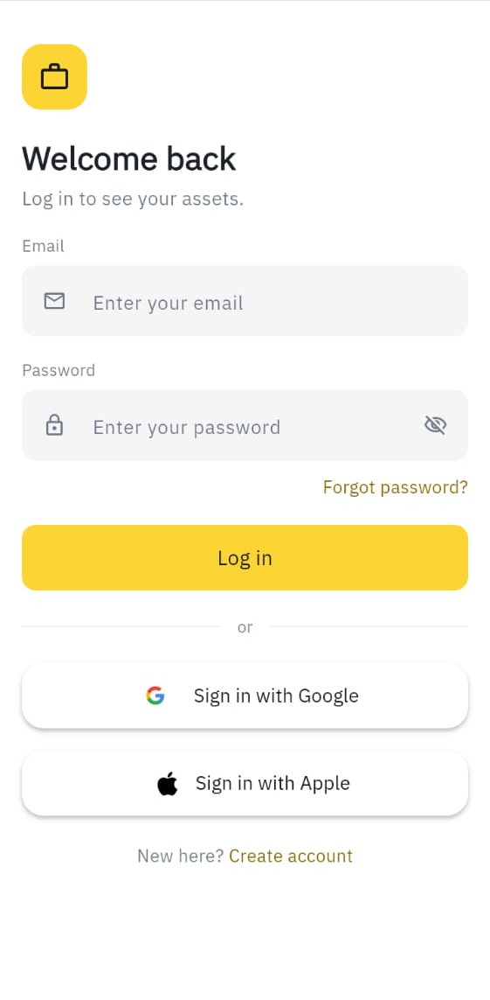
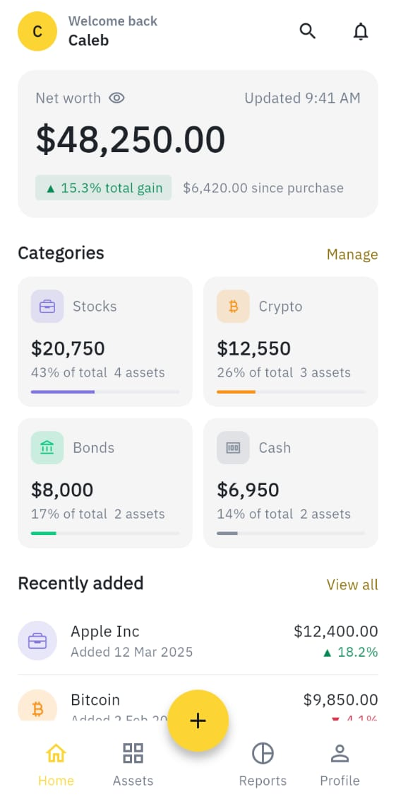
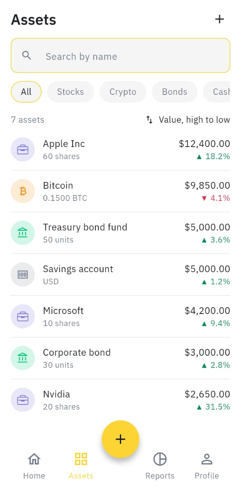
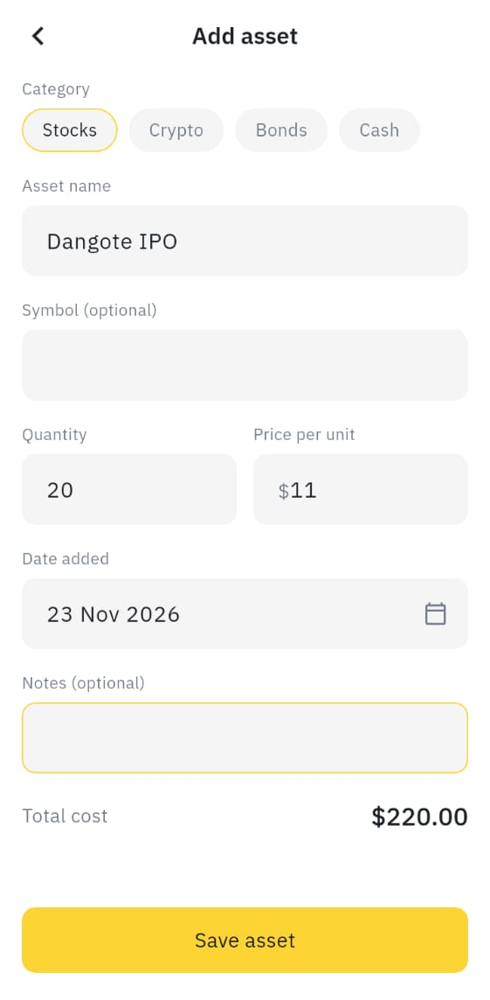
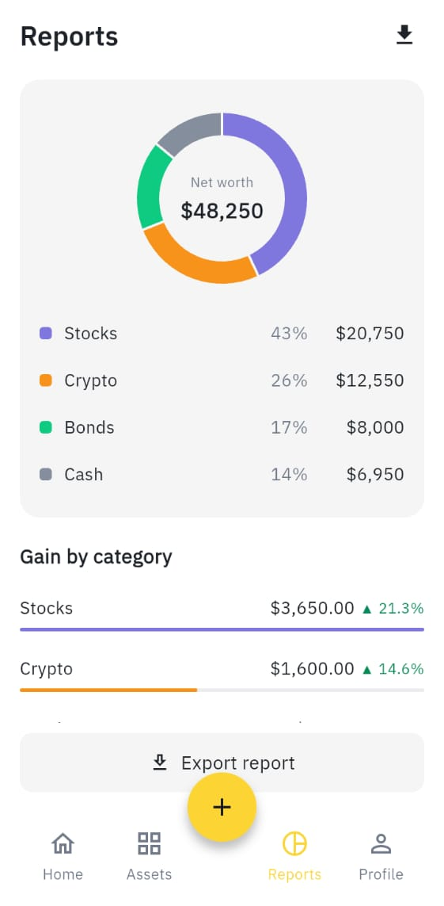
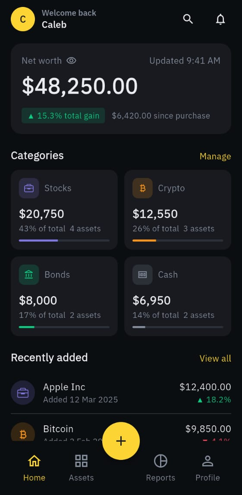
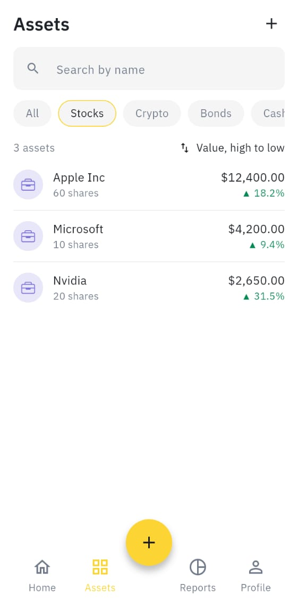
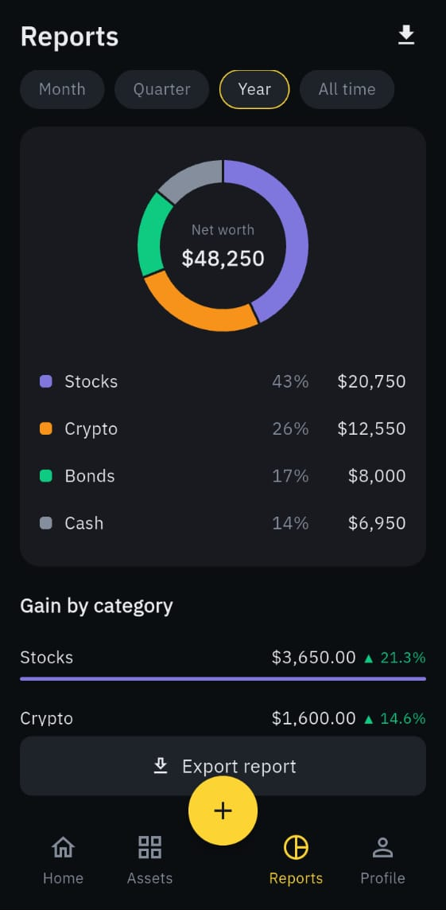
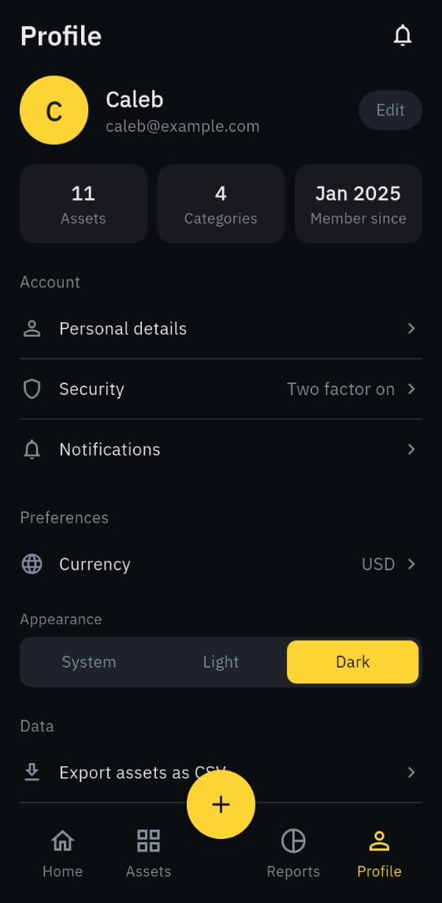
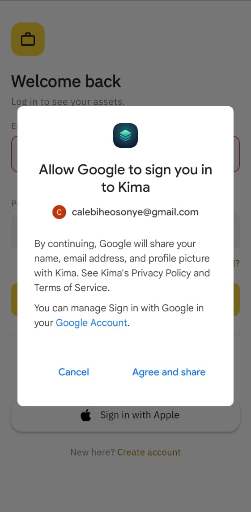

# Kima

A Flutter asset management app for tracking what you own and what it's worth. Kima (Hausa for "value") holds asset data across stocks, crypto, bonds and cash, shows a net-worth breakdown, and exports your records to CSV. It doesn't hold or move money.

This is a front-end showcase. Home, Assets, Reports and Profile run on mock data. Authentication is real and talks to a separate backend ([Asset-App-Backend](https://github.com/Caleb2006-Iheosonye/Asset-App-Backend)).

## Screenshots

<p align="center">
  
  
  
</p>
<p align="center">
  
  
  
</p>

### More screens

<p align="center">
  
  
  
</p>
<p align="center">
  
</p>

## Features

- **Home:** net worth summary, category cards (stocks, crypto, bonds, cash) and recently added assets
- **Assets:** search by name, filter by category, sort by value
- **Add asset:** category, name, symbol, quantity, price per unit, date picker and notes, with live total cost
- **Reports:** net-worth donut chart, allocation by category, gain by category and report export
- **Profile:** account settings, currency, and CSV export of your assets
- **Theming:** light, dark and system modes
- **Auth:** email signup with OTP verification, password recovery and Google sign-in

## Tech stack

- Flutter and Dart
- Custom theming with `ThemeExtension`
- Custom notched bottom navigation bar and named-route navigation
- Next.js and Supabase Auth backend, deployed on Vercel

## Getting started

```bash
git clone https://github.com/Caleb2006-Iheosonye/asset-app.git
cd asset-app
flutter pub get
flutter run
```

## Author

Caleb Iheosonye: [GitHub](https://github.com/Caleb2006-Iheosonye) | [LinkedIn](https://linkedin.com/in/caleb-iheosonye)
